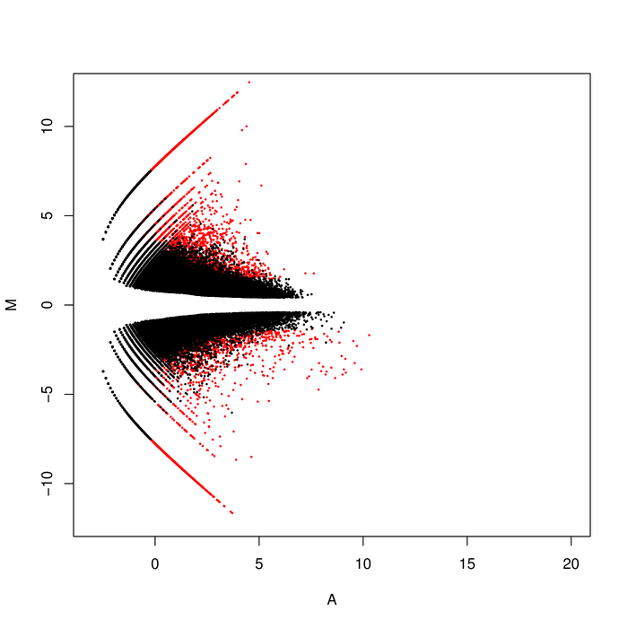
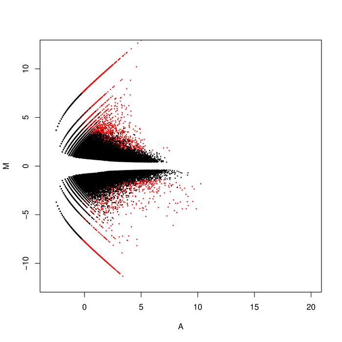
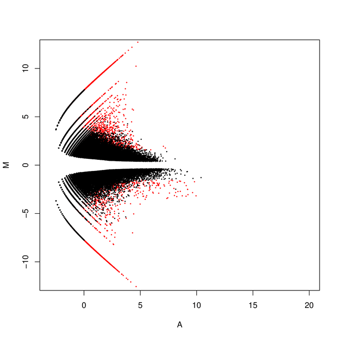
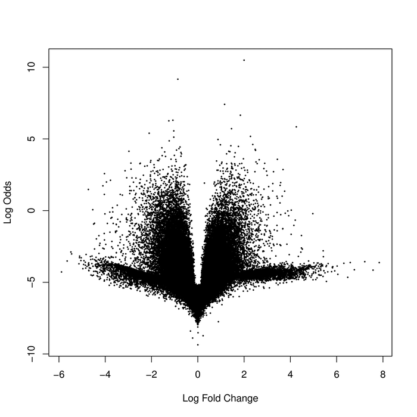
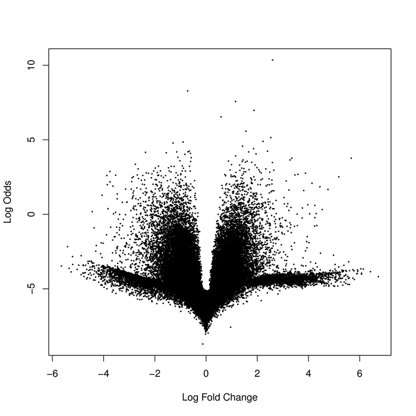
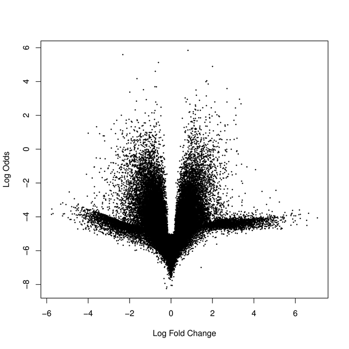

# Differential Gene Expression in *Holothuria glaberrima*

An RNA-seq pipeline that looks for genes involved in the regeneration of the sea cucumber *Holothuria glaberrima*, which can regrow its digestive system after evisceration.

Undergraduate research at the University of Puerto Rico, Río Piedras (2016–2017), supervised by Prof. Humberto Ortiz-Zuazaga. 📄 **[Read the technical report](docs/technical-report.pdf)**

## Highlights

- Built an end-to-end pipeline from raw reads to differential expression: trimming, digital normalization, de novo assembly, quasi-mapping quantification, and statistical testing.
- Replaced the read counting used in an earlier project with **Salmon quasi-mapping**, which estimates abundances without counting every read, to shorten run time.
- Ran the heavy steps (assembly and quantification) as SLURM jobs on the university HPC cluster.
- Found the strongest expression differences early in regeneration (Day 2). The two top Day 2 contigs matched **myosin regulation** and **titin-like** proteins in BLAST, which points to muscle development during regrowth of the digestive tract.

## Pipeline

| Step | Script | Tool |
|---|---|---|
| 1. Trim adapters and low-quality bases | [`pipeline/01-trim.sh`](pipeline/01-trim.sh) | Trimmomatic 0.36 |
| 2. Digital normalization | [`pipeline/02-normalize.sh`](pipeline/02-normalize.sh) | khmer |
| 3. De novo transcriptome assembly | [`pipeline/03-assemble.sh`](pipeline/03-assemble.sh) | Trinity 2.4.0 |
| 4. Build the quasi-mapping index | [`pipeline/04-index.sh`](pipeline/04-index.sh) | Salmon 0.8.2 |
| 5. Quantify each sample | [`pipeline/05-quantify.sh`](pipeline/05-quantify.sh) | Salmon 0.8.2 |
| 6. Sample similarity (MDS) | [`analysis/mds.R`](analysis/mds.R) | edgeR 3.18.1 |
| 7. MA plots, exact test | [`analysis/ma-plot-day-*.R`](analysis) | edgeR 3.18.1 |
| 8. Volcano plots | [`analysis/volcano-plot-day-*.R`](analysis) | limma-voom |

## Data

12 single-end read sets from the NCBI Sequence Read Archive. The 8 Illumina samples were used for the analysis; the 4 sequenced with 454 pyrosequencing were left out so the different sequencing technologies wouldn't skew the results.

| Group | SRA runs |
|---|---|
| Uninjured | SRR490864, SRR490868 |
| Day 2 post-injury | SRR490918, SRR490919 |
| Day 12 post-injury | SRR490920, SRR490921 |
| Day 20 post-injury | SRR490923, SRR490924 |

## Results

The MDS plot separates the uninjured samples clearly from all the regenerating ones. Against the uninjured group, Day 2 shows the most differentially expressed genes, and the effect gets weaker by Day 12 and Day 20.

**MA plots** (red: FDR < 0.2)

| Day 2 vs uninjured | Day 12 vs uninjured | Day 20 vs uninjured |
|---|---|---|
|  |  |  |

**Volcano plots**

| Day 2 vs uninjured | Day 12 vs uninjured | Day 20 vs uninjured |
|---|---|---|
|  |  |  |

See the [technical report](docs/technical-report.pdf) for the full methods, the Day 2 top table, and the BLAST results.

## Reproducing

The scripts are kept as they ran on the UPR cluster, so the paths are absolute and the SLURM headers are cluster-specific. To rerun the pipeline:

1. Download the SRA runs above with `fasterq-dump`.
2. Install Trimmomatic, khmer, Trinity, and Salmon, plus R with `edgeR`, `limma`, and `Biobase`.
3. Update the paths and the `#SBATCH` settings in `pipeline/`, then run the steps in order.
4. Export per-sample count tables from Salmon's output (`*_quant.counts`), then run the R scripts in `analysis/` from that folder.

## Acknowledgements

Thanks to Prof. Humberto Ortiz-Zuazaga, Titus Brown, and lab partners Walter Báez, Kevin Legarreta, and Ángel Sanquiche for their help developing the method and the scripts.
